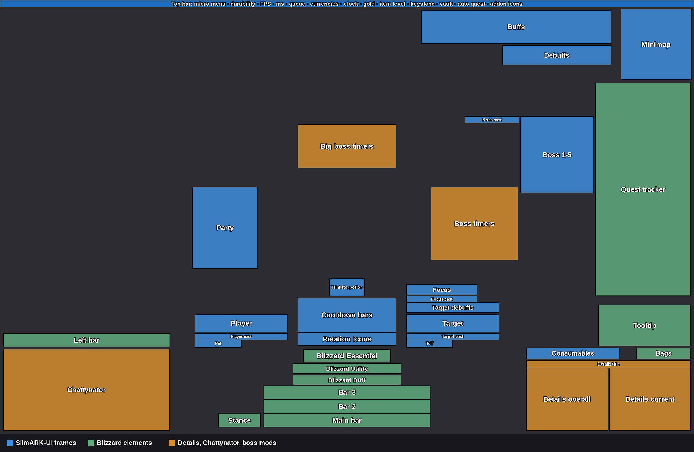
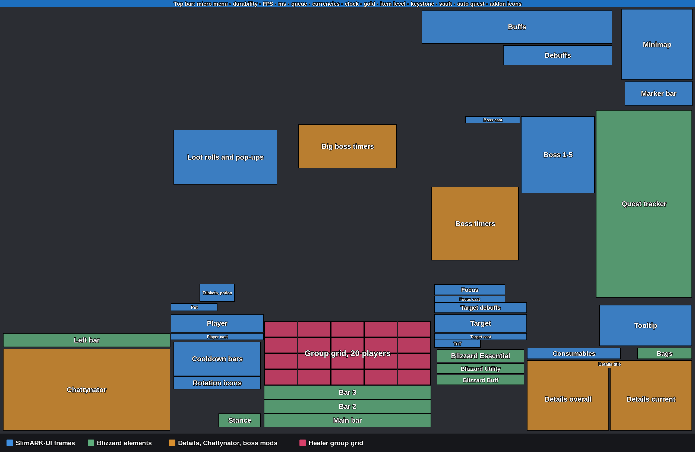

# SlimARK-UI

**A slim, clean and fast interface for World of Warcraft Retail (Midnight) and WoW Forever.**

SlimARK-UI replaces the default unit frames, nameplates, buffs, cooldown tracking and group frames with one consistent, sharp look: flat dark bars, thin black edges, one readable font, and nothing on screen that you do not need in a fight. It is built from scratch on oUF, so it stays light, and it keeps the crisp ElvUI style without ElvUI's pile of extras.

One command sets up your whole screen: frames, Edit Mode layouts, action bars and the skins of your other addons. A settings panel lets you change every element afterwards.

## Quick start

1. Install the addon. The download contains two folders, `SlimARK-UI` and `!SlimARK_Media`. Both are needed: the media folder loads first, so Details!, BigWigs and Chattynator can use the SlimARK font and texture from the start. The same download works in Retail and in WoW Forever.
2. Log in and type `/slimark apply`.
3. Done. Every position and skin is set, and the UI reloads. After each update a window asks for it once; click Apply now.

| Command | What it does |
| --- | --- |
| `/slimark` | Opens the settings panel |
| `/slimark apply` | Sets every position and skin, then reloads the UI |
| `/rl` | Reloads the UI |

## Layouts

The layout follows your spec and fits itself to your screen. The boxes show the real positions and sizes on a 2560×1600 screen: blue is SlimARK-UI, green is Blizzard, orange is Details!, Chattynator and the boss mods.

**DPS and tank**

**Healer**

The group grid sits right above the action bars. A party takes one row, a raid grows upward with five frames in each row.

## Settings panel

Type `/slimark`, click the SlimARK button at the minimap, or open Options → AddOns → SlimARK-UI.

- Every element has its own page in a list on the left: unit frames, party, raid, healer grid, nameplates, buffs, debuffs, cooldown bars, consumables, Mythic+, minimap, action bars, boss mods, Details!, chat, Group Finder and quality of life features
- Sizes, positions, fonts, colors and on/off switches, each with a slider or a box you can type into
- Every page can be reset to the SlimARK defaults on its own
- A search box finds any setting by name
- Changed values are marked in gold
- The version number and the changelog are shown in the panel

## Layouts for every spec

- DPS and tank specs share one layout, built around the center of the screen
- Healers get their own layout, with grid-style group frames right above the action bars where your eyes already are
- The layout switches by itself when you change spec, and waits for the end of combat if needed
- New Edit Mode layouts named `SlimARK-UI` and `SlimARK-UI Heal` are created next to yours

## Unit frames

- Player, target, target of target, pet, focus and boss frames
- Bold, readable font with a soft gloss on the health bars
- Health with one decimal, for example 74.6%
- Class power for every class: runes, combo points, holy power, essence, soul shards, chi, arcane charges, icicles, Maelstrom Weapon and more
- Boss frames show current health in the center, so you can call phase changes at a glance
- Shields (damage absorbs) in light stripes right after the health, on every frame including party, raid and boss frames. Damage takes the striped part first; a shield larger than the missing health is drawn back over the health with a bright line at the edge

## Party, raid and healer frames

- Party frames as large rectangles in a column right next to your character, so you never look far away from the fight
- The party column shows the other four members only, since you have your own player frame. The healer grid includes you
- Wide frames with room for the name, the health, the defensive and the debuff icons side by side
- Role icon on every frame: tank, healer or damage
- Defensive cooldowns on every frame with the time left, both personal and external ones
- Debuff icons on every frame
- The whole frame lights up in the debuff type color (magic, curse, disease, poison) when you can dispel it

## Nameplates

- Your target is marked with a thin frame and two arrows, other plates step back
- The mob's name and its health with one decimal sit inside the plate, not above it
- Casters are marked before they start casting: mana users, mage type mobs and lieutenants. Every mob the addon has seen casting is remembered by name for later runs
- Light blue cast bars for normal casts, magenta for the important ones you should interrupt, so they stand apart from red, orange and yellow plates
- After an interrupt the bar reads "Interrupted" with the name of the player who did it, in class color. In dungeons the game hides the interrupter from addons; your own interrupts are always named, others wherever the game lets the name through
- See which group members target the mob
- Debuffs you applied are shown above the plate
- Enemy shields in light stripes, so you see what has to break first

## Buffs and debuffs

- Large icons next to the minimap, buffs and debuffs in separate rows
- The time left is shown under each icon in a large gold number
- A small gap between icons, so they never run into each other
- Large stack counts with a thick outline

## Cooldowns and consumables

- Slim countdown bars with your spec's own important cooldowns, for all 13 classes
- While a spell's effect is up, like the wings, its bar counts the effect down first with a gold frame, then shows the cooldown
- Active trinket and potion effects: an icon with a gold countdown appears above the cooldown bars while the effect is up, above the player frame for healers. Both trinkets have their own place, the one you use and the one that procs by itself
- A bar updates only when its own spell changes, so busy fights cost almost nothing
- Icon row for your rotation spells, taken from the game's own list for your spec
- Consumable bar for flasks, potions, food and weapon oils, showing what is missing

## Mythic+

- Compact panel in place of the quest tracker while a key runs
- Key level and dungeon name, deaths and the time they cost
- Timer with the +3 and +2 marks and the time left for each
- Enemy forces to two decimals, with the raw count
- One line per boss with its kill time
- The quest tracker steps aside for the whole key, even if the game tries to bring it back in combat, and returns when the key ends

## Group Finder

- Role checks are accepted automatically with your current spec's role
- One click on a premade group listing signs you up with your spec's role, with no extra confirmation window

## Quality of life

- Cinematics and movies you have already seen are skipped automatically
- Vendor shows two pages at once, can hide what you already own, and marks items you lack the currency or reputation for
- Automatic repair at every repair vendor
- The character sheet shows item level, gems, enchants and what is missing on each item
- Square minimap; addon buttons are larger, in a column along its edge on a dark background
- Cleaner, smaller quest tracker with a thin header line
- Move Blizzard windows by their title bar and resize them with Ctrl + mouse wheel; the position is remembered
- Square action buttons with thin black borders; how the buttons work is not touched
- The version number is printed at login

## Skins for your other addons

- **Details!** two windows, overall damage and current fight, in the SlimARK font with clean value columns
- **Deadly Boss Mods** and **BigWigs** bars in the SlimARK look, placed to the right of your character, opposite the party frames
- **Chattynator** dark chat skin in the SlimARK font
- **BetterBags** flat dark SlimARK theme for both the classic bags and BetterBags Next: black edges, cropped item icons, quality colored borders, no glow or bounce

## Your settings stay safe

SlimARK-UI never overwrites your existing profiles or Edit Mode layouts. It creates new ones named `SlimARK-UI` (and `SlimARK-UI Heal` for healers) next to them, so you can switch back at any time from the addon's own profile menu. For BetterBags it only selects the SlimARK theme, which you can change back in BetterBags' theme menu.

## Performance

SlimARK-UI is written to stay out of your frame time:

- Event driven: frames update only when their data changes, never on a timer, apart from the Mythic+ clock while a key runs
- Bursts of spell, talent and bag events are handled once instead of many times
- Panels that are not shown, such as the character sheet overlay, do no work at all

## Good to know

- The layout fits itself to your screen: it is drawn for 2560×1600 and scales automatically on 1080p, 1440p, ultrawide and 4K. Screen edges stay at the edges, everything around your character stays in the middle. Sizes can still be changed in `/slimark` and frames dragged in Edit Mode.
- Made for Midnight's addon rules: it works with the protected values the game uses in combat.
- **WoW Forever:** the same download loads there too. Switch on the Cooldown Manager in the game options for the cooldown bars and the trinket icons. Forever has no Mythic+, so the Mythic+ panel stays off. Details!, the boss mods and the other skinned addons need their own Forever versions.
- Found a bug? Open an issue on [GitHub](https://github.com/tenarkhq/SlimARK-UI/issues) and include the BugSack text.

## Credits

Built with [oUF](https://github.com/oUF-wow/oUF), LibSharedMedia-3.0, LibStub and CallbackHandler-1.0. Font: [Barlow](https://github.com/jpt/barlow), SIL Open Font License 1.1.

## Testers wanted! 🛠️

SlimARK-UI is brand new, and every bug report helps make it better. If you try it in Retail or in WoW Forever, I'd love to hear how it works for you.

**Found a bug?** Please post it in the comments or open an issue on [GitHub](https://github.com/tenarkhq/SlimARK-UI/issues), and include:
- The **BugSack** error text, if there is one (BugGrabber + BugSack catch errors that the game hides)
- A **screenshot** of what looks wrong
- Your **class and spec**, your **screen resolution and UI scale**, and whether it happened in Retail or WoW Forever
- Where it happened: open world, dungeon, Mythic+, raid

**Feature requests** are welcome too. Tell me what you miss, what's in the way, or what another addon does better.

Things I'd especially like feedback on:
- Shields on party and raid frames
- Proc trinkets in the active effects row
- Interrupter names on nameplates in dungeons
- How it runs in **WoW Forever**

Thanks for trying it out!
