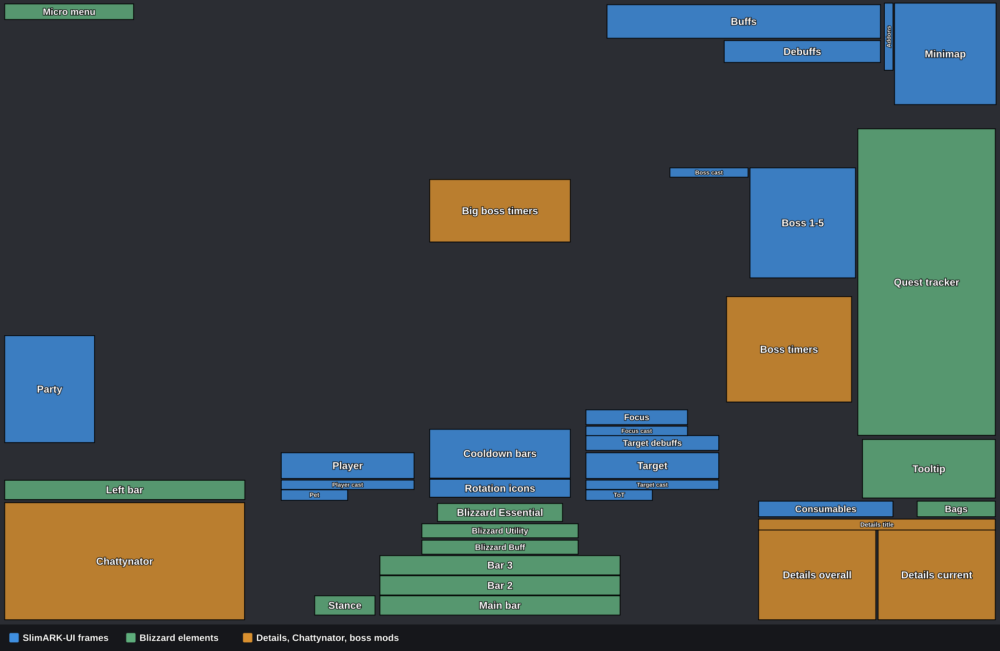
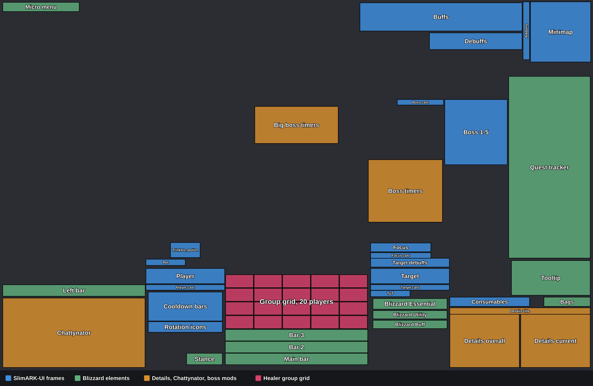

# SlimARK-UI

A slim World of Warcraft UI for Retail (Midnight, 12.x), built from scratch on oUF. It follows the look of ElvUI and LuckyoneUI without the pile of extras.

It is designed for 2560×1600 at 65% UI scale. Every position lives in `SlimARK-UI/Config.lua`, in real pixels.

## Layouts

The layout follows your spec. Boxes show real positions and sizes on a 2560×1600 screen.

**DPS and tank**

**Healer**

The group grid sits right above the action bars. A party takes one row, a raid grows upward with five frames in each row.

## What's included

- Unit frames, party and raid frames, boss frames
- Two layouts that switch with your spec: DPS and tank share one, healers get a grid of group frames above the action bars
- Party and raid frames show defensive cooldowns with time left, debuffs, and a colored border when you can dispel
- Nameplates: highlighted target, casters stand apart, important casts in orange, shows who interrupted a cast and who targets the mob
- Cooldown bars with each spec's own cooldowns for all 13 classes, and a rotation icon row
- Class power for every class: runes, combo points, holy power, essence, soul shards, chi, arcane charges, icicles, Maelstrom Weapon and more
- Buffs, debuffs and dispellable markers
- Consumable bar: flasks, potions, food and weapon oils
- Vendor with two pages, automatic repair
- Character sheet: item level, gems, enchants and what is missing
- Square minimap with addon buttons along its left edge
- Quest tracker skin
- Skins for Details!, DBM, BigWigs and Chattynator
- An Edit Mode layout that puts every Blizzard element in place

It never overwrites your existing profiles or layouts. It creates new ones named `SlimARK-UI` and `SlimARK-UI Heal` next to them.

## Installation

1. Download the zip from the [Releases](https://github.com/tenarkhq/SlimARK-UI/releases) page.
2. Extract it into `World of Warcraft/_retail_/Interface/AddOns`. Both folders are needed: `SlimARK-UI` and `!SlimARK_Media`.
3. In game, type `/slim apply`.

## Commands

| Command | What it does |
| --- | --- |
| `/slim apply` | Sets every position and skin, then reloads the UI |
| `/rl` | Reloads the UI |

SlimARK-UI's own frames can be dragged in Edit Mode, and the DPS and healer layouts remember their positions separately. Blizzard windows move by their title bar and resize with Ctrl + mouse wheel.

The layout follows your spec automatically. If you change spec in combat, it switches when combat ends.

## License

The code is under the [MIT License](LICENSE). The SlimARK-UI logo and icon (`assets/` and `SlimARK-UI/Media/Icon.tga`) are not covered by it.

## Libraries and font

| Name | License |
| --- | --- |
| [oUF](https://github.com/oUF-wow/oUF) | `SlimARK-UI/Libs/oUF/LICENSE.txt` |
| LibSharedMedia-3.0 | LGPL v2.1 |
| LibStub | Public Domain |
| CallbackHandler-1.0 | under the library's own terms |
| [Barlow](https://github.com/jpt/barlow) font | SIL Open Font License 1.1, `SlimARK-UI/Media/SlimARK-font-OFL.txt` |
